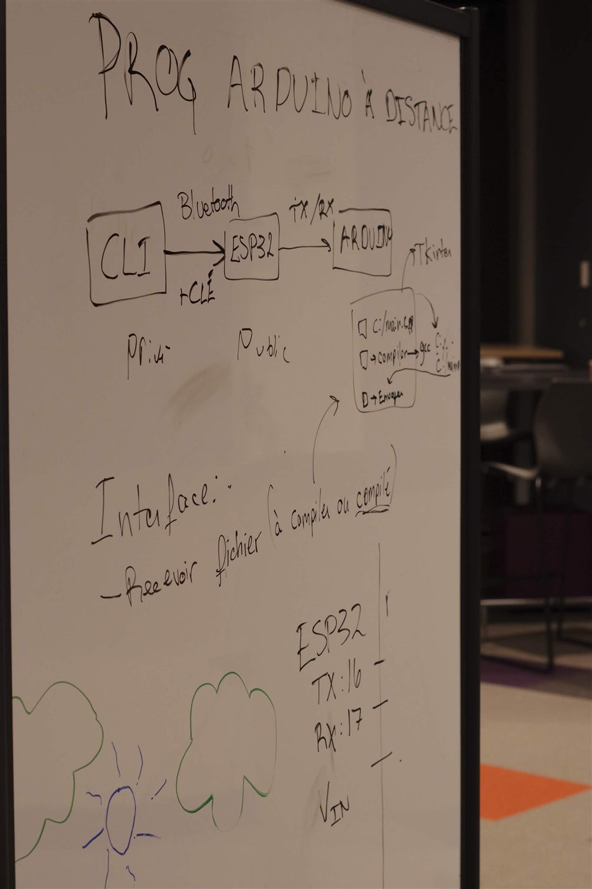

# Shacks Flasher — Téléversement Arduino en un clic

> Utilitaire Windows (WinForms) qui flashe un `.hex` PlatformIO sur un Arduino via `avrdude`, sans ouvrir de terminal.
>
> *Windows WinForms tool that flashes a PlatformIO `.hex` onto an Arduino through `avrdude`, without a terminal.*


---

## Aperçu / Overview

**FR** — Pendant le développement du jeu **Shacks** sur Arduino Mega, recompiler puis retrouver la commande `avrdude` était répétitif. Ce petit outil détecte les ports COM disponibles, propose le type de carte (Mega 2560 / Uno), construit la ligne de commande `avrdude` et affiche la sortie complète dans une zone de texte. Il sert de compagnon au dépôt [`shacks-firmware`](https://github.com/LeVoileuxFaucher/shacks-firmware).

**EN** — While developing the **Shacks** game on an Arduino Mega, rebuilding and retyping the `avrdude` command was tedious. This small tool lists available COM ports, offers the board type (Mega 2560 / Uno), builds the `avrdude` command line and shows the full output in a text box. It is the companion of the [`shacks-firmware`](https://github.com/LeVoileuxFaucher/shacks-firmware) repository.

## Fonctionnalités / Features

- Détection automatique des ports COM au démarrage (`SerialPort.GetPortNames`).
- Sélection du type de carte → MCU `m2560` ou `m328p`.
- Sélection du fichier `.hex` si le chemin PlatformIO par défaut est absent.
- Exécution d'`avrdude` sans fenêtre console, sortie et erreurs capturées.
- Vérification de la présence d'`avrdude` avant lancement, avec message explicite.
- Affichage du résultat dans une `RichTextBox`.

## Commande générée / Generated command

```text
avrdude -C "<avrdude.conf>" -v -p m2560 -c wiring -P COM3 -b 115200 -D
        -U flash:w:"<firmware.hex>":i
```

| Option | Rôle |
|---|---|
| `-p m2560` / `m328p` | Type de MCU |
| `-c wiring` | Programmation via le bootloader Arduino |
| `-P COMx` | Port série sélectionné |
| `-b 115200` | Vitesse du bootloader |
| `-D` | Ne pas effacer la flash avant écriture |
| `-U flash:w:...:i` | Écriture du fichier Intel HEX |

## Concept exploré / Explored concept



*Idée explorée en équipe : programmer l'Arduino à distance via un ESP32 (Bluetooth) et un CLI qui envoie le fichier compilé. Non implémentée dans cet outil, qui flashe en USB via `avrdude`.*

## Prérequis / Requirements

- Windows avec **.NET Framework 4.7.2**.
- **IDE Arduino** installé (fournit `avrdude.exe` et `avrdude.conf`).
- Un projet **PlatformIO** compilé (fichier `.pio/build/<env>/firmware.hex`).

## Compilation / Build

Ouvrir `Shacks.slnx` dans **Visual Studio 2022** (ou MSBuild) et compiler en `Release`, ou :

```powershell
msbuild Shacks.csproj /p:Configuration=Release
```

## Utilisation / Usage

1. Brancher l'Arduino.
2. Lancer l'application, choisir le port COM et le type de carte.
3. Cliquer sur **Flash**.
4. Si le `.hex` n'est pas trouvé, sélectionner le fichier manuellement.
5. Lire la sortie d'`avrdude` dans la zone de texte.

## Limites / Limitations

- Les chemins par défaut d'`avrdude` et du projet PlatformIO sont propres à ma machine ; ils se modifient dans `Form1.cs` (ou via le sélecteur de fichier pour le `.hex`).
- Windows uniquement.
- Pas encore de sauvegarde des préférences entre deux lancements.

## Ce que j'ai appris / What I learned

- Lancer un processus externe depuis .NET et capturer proprement `stdout` / `stderr`.
- Construire une interface WinForms simple et utile autour d'un outil en ligne de commande.
- Gérer les cas d'erreur utilisateur (port non sélectionné, fichier absent, outil manquant).
- Comprendre la chaîne de téléversement Arduino (bootloader, `avrdude`, Intel HEX).

## Crédits / Credits

- **Auteur** : Tristan Faucher.
- `avrdude` : projet open source de la communauté Arduino.
- Projet personnel publié à des fins de portfolio.

## Licence / License

© Tristan Faucher. Tous droits réservés. Code publié à titre de démonstration.
